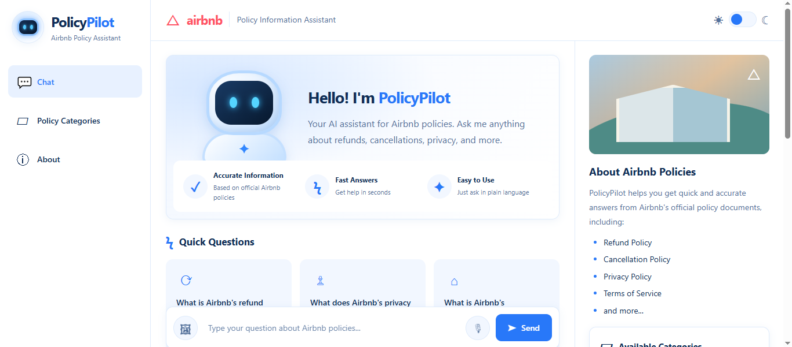
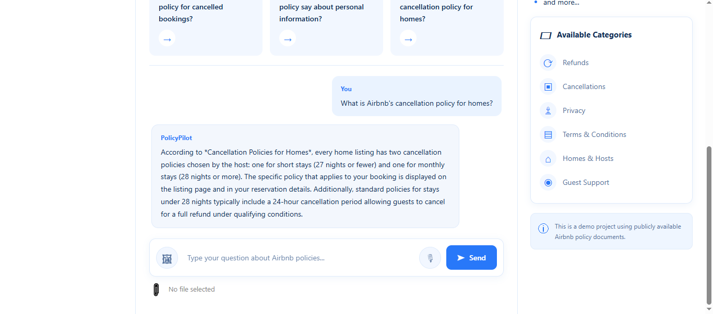
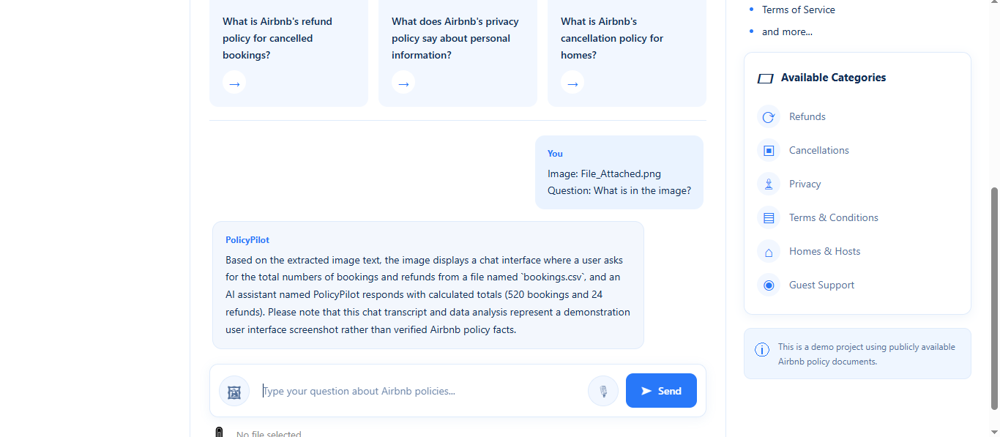
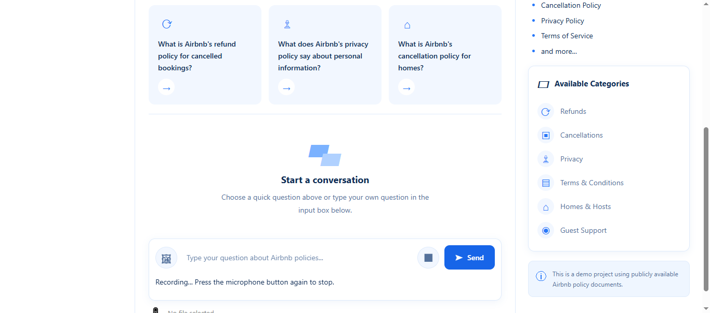
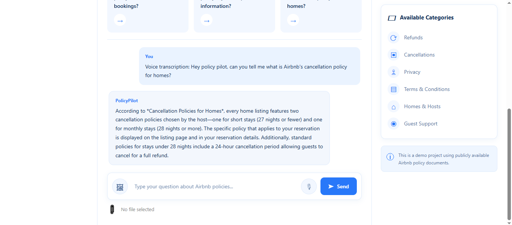
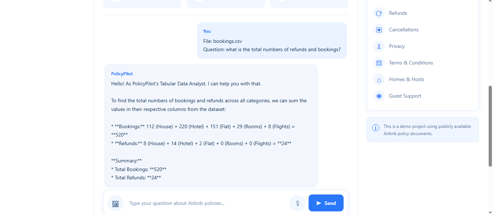

# PolicyPilot AI Agent

An AI-powered policy assistant built with **Python, FastAPI, LangGraph, Google Gemini, ChromaDB, and Retrieval-Augmented Generation (RAG)**.

PolicyPilot helps users interact with policy documents and uploaded datasets through an intelligent chatbot. It supports text-based conversations, image text extraction, audio transcription, and tabular data analysis.

## Features

- **Policy Q&A:** Ask questions about available Airbnb policy documents.
- **RAG Pipeline:** Retrieves relevant policy information from a ChromaDB vector database.
- **Gemini Integration:** Uses Google's Gemini Flash-Lite model to generate responses.
- **Agentic Workflow:** Uses LangGraph to route questions through supported agent workflows.
- **Conversation Memory:** Maintains recent conversation history by session.
- **Policy Tools:** Includes policy search, eligibility-related workflows, and simulated action requests.
- **Image OCR:** Extracts text from uploaded images and uses it to answer user questions.
- **Audio Transcription:** Converts uploaded audio into text and processes the resulting questions.
- **Tabular Data Analysis:** Allows users to upload CSV, Excel, and text-based PDF files and ask questions about their data.
- **Web Interface:** Interactive frontend developed using HTML, CSS, and JavaScript.
- **LangSmith Support:** Supports tracing and monitoring of agent runs.

## Screenshots

### 1. Main Dashboard



### 2. Policy Chat



### 3. Image OCR



### 4. Audio Chat



### 5. Audio Chat Response



### 6. Tabular Data Analysis



## How PolicyPilot Works

### 1. Policy Question Answering

The policy chatbot uses a RAG pipeline to retrieve relevant information from stored policy documents before generating an answer.

```text
User Question
      |
      v
FastAPI API
      |
      v
LangGraph Agent
      |
      v
Question Routing
      |
      v
Policy Retrieval
      |
      v
ChromaDB
      |
      v
Relevant Policy Context
      |
      v
Gemini
      |
      v
Generated Answer
```

### 2. Image Processing

Users can upload images containing text and ask questions about their content.

```text
Uploaded Image
      |
      v
Image OCR
      |
      v
Extracted Text + User Question
      |
      v
Policy Agent
      |
      v
Gemini
      |
      v
Generated Answer
```

### 3. Audio Processing

Users can submit audio questions. The audio is transcribed before being processed by the chatbot.

```text
Uploaded Audio
      |
      v
Audio Transcription
      |
      v
Transcribed Question
      |
      v
Policy Agent
      |
      v
Generated Answer
```

### 4. Tabular Data Analysis

Users can upload structured datasets and ask questions about their contents.

```text
CSV / Excel / PDF
      |
      v
FastAPI API
      |
      v
File Loader
      |
      v
Pandas DataFrame
      |
      v
Data Analysis
      |
      v
Dataset + Summary
      |
      v
Gemini
      |
      v
Generated Answer
```

The tabular workflow is separate from the policy-document RAG pipeline. It uses the uploaded dataset as the source of information.

## Tech Stack

| Technology | Purpose |
|---|---|
| Python | Backend development |
| FastAPI | REST API |
| LangGraph | Agent workflow orchestration |
| LangChain | AI application components |
| Google Gemini API | Response generation |
| ChromaDB | Vector database |
| Sentence Transformers | Text embeddings |
| Pandas | Tabular data processing |
| OpenPyXL | Excel file loading |
| pdfplumber | PDF table extraction |
| HTML | Frontend structure |
| CSS | Frontend styling |
| JavaScript | Frontend functionality |
| LangSmith | Tracing and monitoring |

## Project Structure

```text
PolicyPilot-AI-Agent/
|
├── Backend/
│   ├── API/
│   │   └── chat.py
│   │
│   ├── Agent/
│   │   ├── state.py
│   │   ├── graph.py
│   │   ├── nodes.py
│   │   └── router.py
│   │
│   ├── LLM/
│   │   └── model.py
│   │
│   ├── RAG/
│   │   ├── image_ocr.py
│   │   ├── audio_stt.py
│   │   └── ...
│   │
│   ├── Schemas/
│   ├── Services/
│   │   └── chat_service.py
│   │
│   ├── Tabular/
│   │   ├── __init__.py
│   │   ├── file_loader.py
│   │   ├── data_analyzer.py
│   │   └── pdf_table_extractor.py
│   │
│   ├── VectorDB/
│   ├── config.py
│   └── main.py
│
├── Frontend/
│   ├── index.html
│   ├── style.css
│   └── app.js
│
├── Data/
│   ├── Policies/
│   ├── Uploads/
│   └── ChromaDB/
│
├── Notebooks/
│   └── tabular_data_basics.ipynb
│
├── Screenshots/
│   ├── dashboard.png
│   ├── policy-chat.png
│   ├── image-ocr.png
│   ├── audio-chat.png
│   └── tabular-analysis.png
│
├── Tests/
├── Docs/
├── .env.example
├── .gitignore
├── requirements.txt
└── README.md
```

## Prerequisites

Before running the project, make sure you have:

- Python 3.12 recommended
- Git
- Google Gemini API key
- Internet connection for API requests and initial model downloads

## Installation and Setup

### 1. Clone the Repository

```bash
git clone YOUR_GITHUB_REPOSITORY_URL
cd PolicyPilot-AI-Agent
```

### 2. Create a Virtual Environment

```bash
python -m venv .venv
```

Activate the environment on Windows PowerShell:

```powershell
.\.venv\Scripts\Activate.ps1
```

### 3. Install Dependencies

```bash
python -m pip install --upgrade pip
pip install -r requirements.txt
```

### 4. Configure Environment Variables

Create a `.env` file in the project root and add your Gemini API key.

```env
GEMINI_API_KEY=your_gemini_api_key

LANGSMITH_TRACING=false
LANGSMITH_API_KEY=
LANGSMITH_PROJECT=PolicyPilot-AI-Agent
LANGSMITH_ENDPOINT=https://api.smith.langchain.com
```

**Important:** Never upload your actual `.env` file or API keys to GitHub.

### 5. Prepare Policy Documents

Place your policy PDF documents inside:

```text
Data/Policies/
```

The policy documents are processed and converted into embeddings, which are stored in ChromaDB for retrieval.

If your project setup does not already contain an initialized vector database, run the project's document ingestion and embedding workflow before asking policy questions.

### 6. Run the Backend

From the project root, activate your virtual environment and execute:

```powershell
python -m uvicorn Backend.main:app --reload
```

Backend URL:

```text
http://127.0.0.1:8000
```

### 7. Run the Frontend

Open a second terminal from the project root:

```powershell
python -m http.server 5500
```

Open the application in your browser:

```text
http://127.0.0.1:5500/Frontend/
```

### 8. API Documentation

FastAPI provides interactive API documentation through Swagger UI:

```text
http://127.0.0.1:8000/docs
```

## API Endpoints

| Method | Endpoint | Description |
|---|---|---|
| POST | `/chat` | Handles text-based policy questions |
| POST | `/chat/image` | Processes image-based questions using OCR |
| POST | `/chat/audio` | Transcribes audio and processes questions |
| POST | `/chat/file` | Processes uploaded tabular files and answers questions |

### Supported Tabular File Formats

| Format | Extension | Support |
|---|---|---|
| CSV | `.csv` | Yes |
| Excel | `.xlsx` | Yes |
| Excel | `.xls` | Yes |
| PDF | `.pdf` | Yes, for text-based tables |

## Tabular Data Processing

PolicyPilot includes a dedicated `Tabular` module for handling uploaded datasets.

### File Loader

**File:** `Backend/Tabular/file_loader.py`

Responsible for loading CSV, Excel, and PDF files into Pandas DataFrames.

### Data Analyzer

**File:** `Backend/Tabular/data_analyzer.py`

Generates dataset summaries, including:

- Total rows and columns
- Column names
- Data types
- Missing values
- Numeric statistical summaries

### PDF Table Extractor

**File:** `Backend/Tabular/pdf_table_extractor.py`

Uses `pdfplumber` to extract tables from text-based PDF documents.

### Example Questions

Users can ask questions such as:

- What is the total number of bookings in the hotel category?
- Which category has the highest number of bookings?
- How many refunds are recorded in the dataset?
- What is the total number of bookings across all categories?

The current workflow provides the dataset and its summary to Gemini for question answering.

## Retrieval-Augmented Generation (RAG)

The policy assistant uses a RAG pipeline to generate answers grounded in available policy documents.

The main stages are:

1. Load policy documents.
2. Extract text from documents.
3. Split text into smaller chunks.
4. Generate text embeddings.
5. Store embeddings in ChromaDB.
6. Retrieve relevant chunks based on user questions.
7. Pass retrieved context to Gemini.
8. Generate a response using the available policy information.

## Agentic Workflow

LangGraph organizes the chatbot's supported agent workflows.

The agent maintains state information such as:

- User question
- Retrieved context
- Generated answer
- Selected workflow or tool
- Action details
- Confirmation state
- Conversation history

A routing mechanism determines the appropriate workflow for supported questions.

PolicyPilot combines Generative AI response generation with LangGraph-based agent orchestration.

## Conversation Memory

PolicyPilot maintains recent conversation history using session-based memory.

This allows the chatbot to use relevant previous messages when processing follow-up questions.

## Security and Data Handling

The project uses environment variables to store API credentials.

The following local resources should not be committed to GitHub:

```text
.env
.venv/
Data/ChromaDB/
Data/Uploads/
```

The `.gitignore` file excludes these resources to help protect API keys, local databases, and uploaded files.

## Current Limitations

- Tabular question answering currently relies on Gemini to interpret the dataset and generate responses.
- Deterministic Pandas calculations for every natural-language question are not yet implemented.
- Scanned PDF table extraction is not currently supported.
- The current tabular analysis workflow has a dataset-content size limit of approximately 30,000 characters.
- Some policy-related action workflows are simulated rather than connected to real external services.
- Eligibility assessment accuracy requires further validation.

## Future Improvements

- Deterministic Pandas-based calculations for numerical questions.
- More advanced multi-step agent planning and tool execution.
- Improved eligibility assessment and validation.
- OCR-based extraction from scanned PDFs.
- Persistent uploaded-file sessions.
- Advanced data visualizations and analytics.
- Additional policy sources and document management.
- Integration with external services and APIs.

## License

This project is developed for educational, portfolio, and development purposes.
